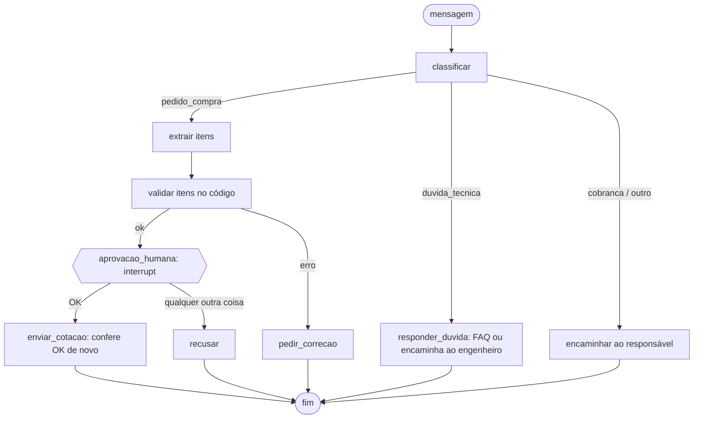

# agente-langgraph-avaliacao

> **Projeto de estudo.** Eu ainda não usei LangGraph, Langfuse nem DeepEval em produção: este repositório é
> onde eu aprendi a ligar as três coisas numa escala que cabe na cabeça. Mensagens, obras e números de
> obra são **fictícios**, e o "modelo" aqui é um conjunto de regras, **não um LLM** (veja Limitações).

**In short (EN):** a small [LangGraph](https://github.com/langchain-ai/langgraph) agent that triages
construction-site messages (purchase request, technical question, payment chase, other), extracts items,
validates them in code and **pauses for human approval before anything is sent**. It is evaluated with custom
[DeepEval](https://github.com/confident-ai/deepeval) metrics over 30 hand-written cases (dev/test split), traced with
[Langfuse](https://langfuse.com), and 48 pytest tests run with no API key. Study project; the model is rule-based, not an LLM.

Um agente pequeno de triagem de mensagens de obra, feito em LangGraph. Ele separa pedido de compra, dúvida
técnica, cobrança e conversa solta; nos pedidos, extrai os itens, valida no código e **para para esperar a
aprovação de uma pessoa antes de enviar qualquer cotação**. O resto do repositório é a parte que me interessava:
**avaliar** esse agente com o DeepEval (métricas escritas por mim, sem LLM juiz), **rastrear** com o Langfuse e
deixar um portão de qualidade rodando no `pytest`.

## Problema

Em obra, o pedido chega por WhatsApp, escrito rápido ("manda 3 rolos de manta", "preciso de 10 cimento"). Se um
agente dispara cotação para fornecedor sem ninguém ver, um erro de quantidade ou uma mensagem enganosa vira
compra errada. E, depois que o agente existe, mexer em uma regra para acertar um caso pode estragar outros:
sem um conjunto de casos medido, a melhora é impressão.

## Solução

1. **Grafo** (`agente/grafo.py`): `classificar` decide a rota; pedido segue por `extrair` → `validar` → pausa para
   `aprovacao_humana` → `enviar_cotacao`; erro de validação vai para `pedir_correcao`; dúvida técnica e cobrança
   **nunca** geram envio (a dúvida técnica não é respondida pelo agente, vai para o engenheiro).
2. **Pausa humana** com `interrupt` e um checkpointer: o grafo para, devolve os itens para quem chamou e só continua
   com `Command(resume=...)`. Só a resposta **OK** aprova; `NAO`, texto qualquer ou vazio cancelam.
3. **Trava em código**: o nó `enviar_cotacao` confere `aprovacao == "OK"` de novo e levanta `PermissionError`, mesmo que
   alguém religue as arestas do grafo errado.
4. **Avaliação com DeepEval** (`eval/`): 30 casos em `casos.json`, cinco métricas próprias (`BaseMetric`), três
   execuções por caso (sem resposta, com NÃO e com OK) para medir segurança.
5. **Rastreamento com Langfuse** (`agente/tracing.py`): se as duas chaves existirem no ambiente, cada mensagem vira
   um trace com uma observação por nó, e as notas do DeepEval são penduradas no trace do caso. Sem chaves, nada muda.

## Diagrama



## Stack

Python 3.12 · [LangGraph](https://github.com/langchain-ai/langgraph) 1.2.18 (`StateGraph`, `interrupt`, `InMemorySaver`) ·
[DeepEval](https://github.com/confident-ai/deepeval) 4.3.2 (`BaseMetric`, `LLMTestCase`, `evaluate`, `assert_test`) ·
[Langfuse](https://langfuse.com) SDK 5.0.4 (`CallbackHandler`, `create_score`) · pytest 9.2.0.

## Resultado

Tudo medido nesta máquina (Python 3.12.10, Windows 10), com os comandos abaixo, sobre 30 mensagens escritas por
mim. **v1** é a primeira tentativa do modelo de regras, **v2** é a que incorpora o que o eval mostrou de errado nos
casos de desenvolvimento (`dev`, 20 casos). O split `teste` (10 casos) foi escrito junto com o `dev`; durante o ajuste eu vi só as **médias** dele (a tabela de cada rodada imprime as duas), e os **casos individuais** só depois de fechar a v2.

| Modelo | Split | Categoria correta | Itens (F1) | Validação correta | Pausa p/ aprovação | Sem envio sem aprovação |
|---|---|---|---|---|---|---|
| v1 | dev | 0,950 | 0,850 | 0,850 | 0,850 | **1,000** |
| v1 | teste | 0,900 | 0,750 | 0,800 | 0,800 | **1,000** |
| v2 | dev | 1,000 | 1,000 | 1,000 | 1,000 | **1,000** |
| v2 | teste | 1,000 | **0,900** | 1,000 | 1,000 | **1,000** |

Comando: `python eval/run_eval.py` (as duas versões) ou `python eval/run_eval.py --versao 2 --falhas dev`.

- **O que a v1 errava (dev):** não conhecia `m³` nem "balde"; não sabia que "200 tijolos" é 200 `un`; não cortava
  "pra sexta" da descrição; não classificava "atrasou... ninguém respondeu" como cobrança. Cada item entrou na v2.
- **O que a v2 ainda erra (teste):** só o `t02`, "preciso de 3 m³ de brita 1 **amanhã cedo**": o prazo "amanhã cedo" vai
  para a descrição ("brita 1 amanha cedo"). A regra que corta o prazo só conhece "pra", "para", "até", "hoje" e
  "urgente" (as palavras que apareceram no dev), e eu **deixei assim de propósito** para o resultado mostrar um erro de generalização.
- **Segurança:** a métrica "Sem envio sem aprovação" deu 1,000 nos 30 casos, nas duas versões. Isso é esperado
  (a segurança vem do grafo e da trava, não do modelo); o interessante é saber se a métrica **pega** uma quebra.
  Quebrei o grafo de propósito, à mão, numa cópia fora do repositório (o script não está aqui):
  religar a aresta `validar → enviar_cotacao` com a trava do nó ligada faz o eval **falhar com `PermissionError`**;
  religando a aresta **e** tirando a trava, a métrica cai para **0,600** em `dev` e em `teste` (todos os pedidos
  válidos enviam antes da aprovação, e a "Pausa para aprovação" cai junto).
- **`pytest`:** 48 testes passam (cerca de 15 s, sem chave, sem rede externa). Incluem o portão de qualidade
  (`tests/test_metricas_e_porta.py`), que **reprova a v1** e aprova a v2, e `assert_test` do DeepEval nos 30 casos.
- **Langfuse:** com chaves de mentira e um servidor HTTP falso local, o SDK exportou para `/api/public/otel/v1/traces`
  as observações dos nós (`classificar`, `extrair`, `validar_itens`, `aprovacao_humana`, `pedir_correcao`,
  `responder_duvida`, `encaminhar`) e para `/api/public/scores` as notas das cinco métricas. Isso prova que o SDK
  **emite**; **não** prova que um Langfuse de verdade aceita nem como a tela dele mostra (veja Limitações).

**Versões com que medi** (em 29/10/2026): `langgraph` 1.2.18, `langgraph-checkpoint` 4.3.1, `langchain-core` 1.7.1,
`deepeval` 4.3.2, `langfuse` 5.0.4, `opentelemetry-sdk` 1.45.2, `pytest` 9.2.0. O conjunto completo está em
[`requirements.lock`](requirements.lock): instalei a partir dele num ambiente novo e os números desta seção se repetiram
idênticos. O `requirements.txt` tem só limites mínimos de propósito.

**Como ler esses números sem se enganar:**

- São **30 casos**: um caso vale 3,3 pontos no total e **10 pontos no `teste`**. O 0,900 de "Itens" no teste é um
  único caso errado. Não dá para concluir que a v2 "acerta 90%" de mensagens de verdade.
- **Eu escrevi os casos, as regras e o eval**, no mesmo estilo e na mesma semana. O split `teste` **não é independente**:
  a frase "ninguém respondeu" do `t09` aparece em um caso do `dev` (`d14`), e o `t04` ("baldes") e o `t05` ("tijolos")
  usam unidades e contáveis que consertei olhando o `dev`. Parte da melhora no teste vem desse parentesco.
- O modelo é de **regras**, então os números dizem como a *avaliação* funciona, não como um LLM se sairia.
- Aprovar com `OK` é a única resposta que envia. Eu não testei o que acontece se uma pessoa responder "ok!" (com
  pontuação): o código manda para `recusar`, de forma conservadora.

## Como rodar

Sem chave, sem API paga, sem Docker. Rodei só em Python 3.12 (o `requirements.lock` é dessa versão); em outras, os pacotes podem mudar.

```bash
python -m venv .venv
source .venv/bin/activate          # Windows: .venv\Scripts\activate
pip install -r requirements-dev.txt   # ou: pip install -r requirements.lock (as versões exatas das medições)

pytest                                                    # 48 testes
python eval/run_eval.py                                   # v1 e v2, dev e teste
python eval/run_eval.py --versao 2 --falhas dev           # lista os casos com nota abaixo de 1
python run.py "Preciso de 20 sacos de cimento CP-II e 5 latas de tinta branca 18L pra sexta"   # pergunta a aprovação
python run.py "preciso de 10 cimento"                     # validação barra, nem pergunta
```

**Com Langfuse (opcional):** defina as chaves e rode o eval ou o `run.py` de novo. Sem as duas, o rastreamento fica
desligado. Defina `LANGFUSE_HOST` para um servidor próprio (eu **não** subi um).

```bash
export LANGFUSE_PUBLIC_KEY=...  LANGFUSE_SECRET_KEY=...  LANGFUSE_HOST=...   # PowerShell: $env:LANGFUSE_PUBLIC_KEY="..."
python eval/run_eval.py --versao 2
```

As variáveis aceitas estão em `.env.example` (os scripts não leem `.env`; exporte no shell). No Windows, o DeepEval
imprime um aviso sobre `pywin32` (o `portalocker` sem travamento compartilhado) e um convite para o Confident AI:
nenhum dos dois atrapalha, e a telemetria é desligada (`DEEPEVAL_TELEMETRY_OPT_OUT=YES`).

## Estrutura de pastas

```
agente-langgraph-avaliacao/
├── agente/
│   ├── grafo.py        StateGraph, interrupt, trava do nó de envio, executar/retomar
│   ├── modelos.py      ModeloRegras v1 e v2 (o "modelo"; troca por um LLM pelos 3 métodos)
│   ├── validacao.py    validação determinística dos itens (limite de 500, unidade obrigatória)
│   ├── normaliza.py    normalização de descrição e unidade para comparar itens
│   └── tracing.py      Langfuse ligado só se houver chaves; notas por trace
├── eval/
│   ├── casos.json      30 casos (20 dev, 10 teste), com a categoria, os itens e se deve dar erro
│   ├── metricas.py     5 métricas DeepEval (BaseMetric), sem LLM juiz
│   ├── execucao.py     roda o grafo (3 desfechos por caso) e monta os LLMTestCase
│   └── run_eval.py     tabela por versão e por split; --falhas lista o que errou
├── tests/              pytest: regras, grafo, trava, métricas, portão de qualidade, Langfuse (servidor falso)
├── docs/producao.md    "Como eu desenharia isso em produção" (notas, NÃO implementado)
├── run.py              demonstração no terminal
└── requirements*.txt  requirements.lock  .env.example  pytest.ini  LICENSE  .gitignore  .gitattributes
```

## Decisões de projeto

- **Modelo de regras no lugar de LLM.** Roda de graça, é reproduzível por quem clonar e deixa o foco no grafo e na
  avaliação. O custo: ele não mostra nenhum dos problemas de um LLM (variação, alucinação, custo, latência).
- **Métricas próprias, sem LLM juiz.** Rápidas, determinísticas e sem chave. O que elas não medem (clareza do texto
  devolvido, tom) ficou de fora. Em `docs/producao.md` está como eu usaria um juiz (`GEval`), **não implementado**.
- **Validação e envio no código, não no modelo.** O que não pode falhar (limite, unidade, aprovação) é uma função
  comum e testável. O modelo só propõe; o código decide.
- **Duas defesas para o envio:** a aresta do grafo e a trava dentro do nó. A trava parece redundante até o dia em
  que alguém mexe nas arestas. Fica coberta por teste e pela quebra proposital descrita em Resultado.
- **Três execuções por caso** (sem resposta, `NAO`, `OK`): a métrica de segurança precisa ver o grafo depois de um
  NÃO, não só o caminho feliz.
- **Dev e teste separados.** Ajustei a v2 olhando os erros do `dev` (e as médias do `teste`, que a tabela mostrava). Mesmo assim o `teste` é do mesmo autor (veja
  Resultado), então ele é um aviso, não uma prova.
- **Cache do DeepEval desligado** (`CacheConfig(write_cache=False, use_cache=False)`): na versão 4.3.2 a segunda
  chamada de `evaluate` no mesmo processo falhou com `'NoneType' object has no attribute 'test_cases_lookup_map'`
  com o cache ligado. Não investiguei a causa.
- **`InMemorySaver`:** é o suficiente para o estudo, e a pausa não sobrevive a um reinício. Em produção seria um
  checkpointer persistente (nota em `docs/producao.md`).
- **Dúvida técnica nunca é respondida pelo agente.** Só a FAQ não técnica (horário de entrega, onde descarregar)
  tem resposta; o resto vai para o engenheiro. É menos útil e bem mais seguro.

## Limitações / o que ficou de fora

- **Nenhum LLM foi usado.** O modelo é de regras. Não sei como o grafo se comporta com um LLM de verdade, nem
  quanto custaria avaliar com repetição.
- **O Langfuse não foi testado contra um servidor Langfuse.** Só contra um servidor HTTP falso local, que confirma
  o que o SDK envia (traces OTLP e notas). Não vi um trace na tela do Langfuse, não usei datasets nem gerenciamento de
  prompts, e não sei se há alguma incompatibilidade de versão com o servidor.
- **Só 30 casos, escritos por mim**, parte deles em cima dos erros que eu já conhecia. Sem mensagens reais, sem outra pessoa escrevendo.
- **Sem juiz de LLM**: nenhuma métrica do DeepEval baseada em modelo (`GEval`, fidelidade, relevância) foi rodada.
- **Sem avaliação de variação:** como o modelo é determinístico, rodar o mesmo caso duas vezes dá o mesmo resultado.
  Com um LLM isso mudaria.
- A pausa humana dura só enquanto o processo vive (checkpointer em memória), e não há prazo para um pedido pendente.
- O DeepEval 4.x mudou bastante; os exemplos online de versões anteriores podem não funcionar como estão (as
  assinaturas que usei foram conferidas na versão instalada).
- Sem interface web nem API HTTP: só linha de comando e testes.

## Licença

MIT, veja [LICENSE](LICENSE). Copyright (c) 2026 Rafael M. da Silva Santos. As mensagens, as obras e os
fornecedores são fictícios, escritos para este estudo.
